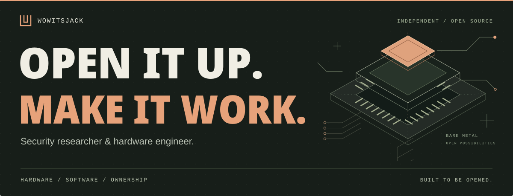

<picture>
  <source media="(max-width: 600px)" srcset="assets/profile-hero-mobile.svg">
  
</picture>

I build tools that give people more control over their hardware. My work spans device research, embedded firmware, and making software run where it should.

## Selected work

<a href="https://github.com/wowitsjack/freeMarkable">
  <picture>
    <source media="(max-width: 600px)" srcset="assets/freemarkable-mobile.svg">
    
  </picture>
</a>

<a href="https://github.com/wowitsjack/choochoo-loader">
  <picture>
    <source media="(max-width: 600px)" srcset="assets/choochoo-mobile.svg">
    
  </picture>
</a>

<a href="https://github.com/wowitsjack/ai-v">
  <picture>
    <source media="(max-width: 600px)" srcset="assets/aiv-mobile.svg">
    
  </picture>
</a>

## Also on the bench

**[readmarkable](https://github.com/wowitsjack/readmarkable)** · Offline document management for reMarkable.

**[Bedside Lamp 2](https://github.com/wowitsjack/esphome-xiaomi-bslamp2-mcp)** · ESPHome firmware, on-device lighting effects, and MCP control.

**[AI Audiobook Maker](https://github.com/wowitsjack/AI-Audiobook-Maker)** · Audiobook generation with Gemini TTS and Lyria music.

**[Peacock for Steam Deck](https://github.com/wowitsjack/Hitman-Peacock-SteamDeck)** · A SteamOS launcher for the Peacock HITMAN server emulator.

---

<strong>Working across</strong> &nbsp; Linux · Android · embedded systems · reverse engineering 
<strong>Working with</strong> &nbsp; C / C++ · Python · C# · Shell

[Explore all repositories ↗](https://github.com/wowitsjack?tab=repositories)
