<picture>
  <source media="(max-width: 600px) and (prefers-reduced-motion: reduce)" srcset="assets/motion/hero-mobile-still.svg">
  <source media="(prefers-reduced-motion: reduce)" srcset="assets/motion/hero-still.svg">
  <source media="(max-width: 600px)" srcset="assets/motion/hero-mobile.svg">
  
</picture>

I build tools that give people more control over their hardware. I also maintain browser-fuzzing and game-decompilation projects.

## Selected work

<a href="https://github.com/ChijinZ/SaGe-Browser-Fuzzer">
  <picture>
    <source media="(max-width: 600px) and (prefers-reduced-motion: reduce)" srcset="assets/motion/sage-upstream-mobile-still.svg">
    <source media="(prefers-reduced-motion: reduce)" srcset="assets/motion/sage-upstream-still.svg">
    <source media="(max-width: 600px)" srcset="assets/motion/sage-upstream-mobile.svg">
    
  </picture>
</a>

<a href="https://github.com/shubshub/fftadecomp">
  <picture>
    <source media="(max-width: 600px) and (prefers-reduced-motion: reduce)" srcset="assets/motion/ffta-mobile-still.svg">
    <source media="(prefers-reduced-motion: reduce)" srcset="assets/motion/ffta-still.svg">
    <source media="(max-width: 600px)" srcset="assets/motion/ffta-mobile.svg">
    
  </picture>
</a>

<a href="https://github.com/wowitsjack/freeMarkable">
  <picture>
    <source media="(max-width: 600px) and (prefers-reduced-motion: reduce)" srcset="assets/motion/freemarkable-mobile-still.svg">
    <source media="(prefers-reduced-motion: reduce)" srcset="assets/motion/freemarkable-still.svg">
    <source media="(max-width: 600px)" srcset="assets/motion/freemarkable-mobile.svg">
    
  </picture>
</a>

<a href="https://github.com/wowitsjack/choochoo-loader">
  <picture>
    <source media="(max-width: 600px) and (prefers-reduced-motion: reduce)" srcset="assets/motion/choochoo-mobile-still.svg">
    <source media="(prefers-reduced-motion: reduce)" srcset="assets/motion/choochoo-still.svg">
    <source media="(max-width: 600px)" srcset="assets/motion/choochoo-mobile.svg">
    
  </picture>
</a>

## Also on the bench

<a href="https://github.com/wowitsjack/ai-v">
  <picture>
    <source media="(max-width: 600px) and (prefers-reduced-motion: reduce)" srcset="assets/motion/aiv-mobile-still.svg">
    <source media="(prefers-reduced-motion: reduce)" srcset="assets/motion/aiv-still.svg">
    <source media="(max-width: 600px)" srcset="assets/motion/aiv-mobile.svg">
    
  </picture>
</a>

<a href="https://github.com/wowitsjack/readmarkable">
  <picture>
    <source media="(max-width: 600px) and (prefers-reduced-motion: reduce)" srcset="assets/motion/readmarkable-mobile-still.svg">
    <source media="(prefers-reduced-motion: reduce)" srcset="assets/motion/readmarkable-still.svg">
    <source media="(max-width: 600px)" srcset="assets/motion/readmarkable-mobile.svg">
    
  </picture>
</a>

<a href="https://github.com/wowitsjack/esphome-xiaomi-bslamp2-mcp">
  <picture>
    <source media="(max-width: 600px) and (prefers-reduced-motion: reduce)" srcset="assets/motion/lamp-mobile-still.svg">
    <source media="(prefers-reduced-motion: reduce)" srcset="assets/motion/lamp-still.svg">
    <source media="(max-width: 600px)" srcset="assets/motion/lamp-mobile.svg">
    
  </picture>
</a>

<a href="https://github.com/wowitsjack/AI-Audiobook-Maker">
  <picture>
    <source media="(max-width: 600px) and (prefers-reduced-motion: reduce)" srcset="assets/motion/audiobook-mobile-still.svg">
    <source media="(prefers-reduced-motion: reduce)" srcset="assets/motion/audiobook-still.svg">
    <source media="(max-width: 600px)" srcset="assets/motion/audiobook-mobile.svg">
    
  </picture>
</a>

<a href="https://github.com/wowitsjack/Hitman-Peacock-SteamDeck">
  <picture>
    <source media="(max-width: 600px) and (prefers-reduced-motion: reduce)" srcset="assets/motion/peacock-mobile-still.svg">
    <source media="(prefers-reduced-motion: reduce)" srcset="assets/motion/peacock-still.svg">
    <source media="(max-width: 600px)" srcset="assets/motion/peacock-mobile.svg">
    
  </picture>
</a>

[Explore all repositories ↗](https://github.com/wowitsjack?tab=repositories)
